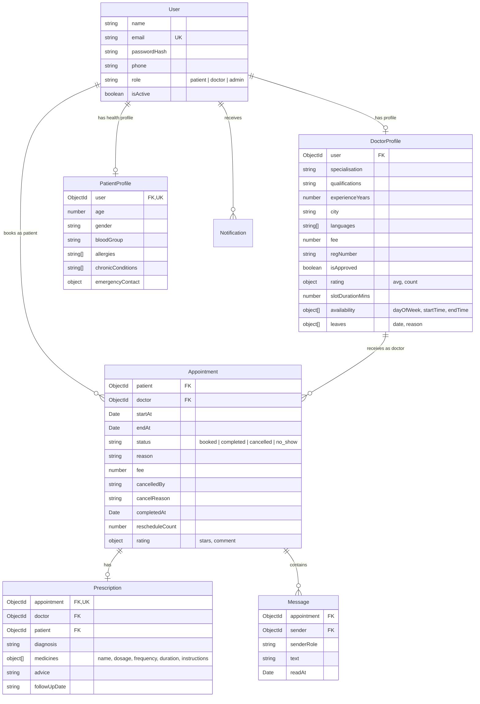

# MediConnect - Doctor Appointment Platform

MediConnect is a full-stack doctor appointment and consultation platform built with the MERN stack (MongoDB, Express, React, Node.js). It enables patients to discover verified clinicians, view live computed timetable slots, reserve guaranteed bookings with zero double-booking risk, communicate asynchronously via consultation chat, and access allergy-screened digital prescriptions. Clinicians manage multi-shift weekly availability, schedule leaves with conflict warnings, review their day/week schedule, issue prescriptions, and converse with patients. Platform administrators review and approve medical practitioner registrations.

---

## 1. Key Features

- **Dynamic Slot Generation:** Consultation time slots are computed on demand in real-time from the doctor's weekly timetable rules and scheduled leaves—never pre-generated or bulk-inserted into the database.
- **Zero Double-Booking Guarantee:** Enforces atomic database-level slot locks via a MongoDB **Partial Unique Index** (`{ doctor: 1, startAt: 1 }` where `status: 'booked'`). If two patients attempt to book the exact same slot concurrently, exactly one succeeds (HTTP 201) and all others receive a conflict response (HTTP 409).
- **Asynchronous Consultation Chat:** Each booked or completed consultation has an isolated messaging thread between the patient and doctor. Includes 5-second polling (auto-paused when the browser tab is hidden), manual refresh, delivery and seen status tracking, and optimistic message rendering.
- **Digital Prescriptions with Allergy Collision Warnings:** Consulting doctors issue formatted digital prescriptions with dynamic medicine rows (dosage, frequency, duration, instructions). The system cross-references prescribed medicines against the patient's recorded allergies and displays non-blocking safety warnings. Includes an optimized print stylesheet (`window.print()`).
- **Weekly Schedule & Leave Management:** Doctors customize multi-shift working hours per weekday (e.g. split morning/afternoon shifts) and record leaves. Adding a leave date automatically analyzes existing bookings and flags conflicts without destructive auto-cancellation.
- **Strict Role-Based Access Control (RBAC) & Ownership Security:** Patients can only access their own consultations and medical history. Doctors can only view health profiles of patients who have booked consultations with them.
- **Admin Approval Pipeline:** New doctor registrations start in an unapproved state and must be verified by an administrator before appearing on the public booking directory.

---

## 2. Tech Stack & Architectural Decisions

| Layer | Technology | Decision Justification |
| :--- | :--- | :--- |
| **Backend** | Node.js (v18+) & Express | Standard, battle-tested asynchronous runtime and REST framework. |
| **Database** | MongoDB & Mongoose | Flexible document model with standalone compatibility (no replica set transactions required). |
| **Date/Time** | Luxon | Immutable date-time calculations, seamless timezone handling, and DST-safe arithmetic. |
| **Auth & Security** | JWT, bcryptjs, Helmet, Rate Limit | Stateless 7-day bearer tokens, salted password hashing (cost 10), header hardening, and auth route protection. |
| **Frontend** | React 18 + Vite | Modern JSX, fast development HMR, and efficient component re-rendering. |
| **State** | React Context API | Lightweight global session state without third-party boilerplate like Redux. |
| **Styling** | Tailwind CSS | Healthcare-themed teal/slate design, fully responsive grid layouts, and custom print media queries. |
| **HTTP Client** | Axios | Request interceptors for automatic JWT injection and centralized error handling. |
| **Testing** | Jest + Supertest + mongodb-memory-server | Fast in-memory unit and integration tests including concurrency stress testing. |

---

## 3. How to Run in 4 Steps

### Step 1: Install Dependencies
From the repository root:
```bash
npm run install-all
```
*(Installs root, backend, and frontend packages).*

### Step 2: Environment Configuration
Environment files are pre-configured with default development values. If needed, verify or copy:
```bash
# In backend/
copy .env.example .env

# In frontend/
copy .env.example .env
```

**Backend `.env` defaults:**
- `PORT=5000`
- `NODE_ENV=development`
- `MONGO_URI=mongodb://127.0.0.1:27017/mediconnect` *(or your MongoDB Atlas connection string)*
- `JWT_SECRET=mediconnect_dev_jwt_secret_key_change_in_production_12345`
- `JWT_EXPIRES_IN=7d`
- `FRONTEND_URL=http://localhost:5173`
- `APP_TIMEZONE=Asia/Kolkata`
- `MIN_NOTICE_MINS=60`
- `BOOKING_HORIZON_DAYS=14`

> **Zero-Setup Database Note:** If you do not have MongoDB installed locally, the backend automatically detects that port 27017 is offline and transparently starts a persistent standalone MongoDB instance with storage in `backend/.mongodb-data`. It works out of the box with zero external dependencies!

### Step 3: Seed Database
Seed the database with 1 admin, 12 approved doctors across 8 specialisations, 1 pending doctor, 6 patients, sample appointments, chat threads, and prescriptions:
```bash
npm run seed
```

### Step 4: Run Application
Start both backend (port 5000) and frontend (port 5173) with a single command:
```bash
npm run dev
```

- **Frontend:** [http://localhost:5173](http://localhost:5173)
- **Backend API:** [http://localhost:5000/api](http://localhost:5000/api)
- **API Health Check:** [http://localhost:5000/health](http://localhost:5000/health)

---

## 4. Demo Credentials

All seeded demo accounts share the password: **`Password@123`**

| Role | Email | Name & Details |
| :--- | :--- | :--- |
| **Admin** | `admin@demo.com` | System Admin (Doctor Approvals & Statistics) |
| **Doctor 1** | `doctor1@demo.com` | Dr. Rajesh Khanna (General Physician, Mumbai) |
| **Doctor 2** | `doctor2@demo.com` | Dr. Sunita Rao (Cardiologist, Bengaluru - Split Shift) |
| **Doctor 3** | `doctor3@demo.com` | Dr. Amitav Sen (Dermatologist, Delhi - Scheduled Leave Tomorrow) |
| **Doctor 4** | `doctor4@demo.com` | Dr. Meera Nambiar (Pediatrician, Chennai) |
| **Doctor 5** | `doctor5@demo.com` | Dr. Arjun Kapoor (Orthopedic, Mumbai) |
| **Doctor 6** | `doctor6@demo.com` | Dr. Kavita Deshmukh (Gynecologist, Pune) |
| **Doctor 7** | `doctor7@demo.com` | Dr. Farhan Qureshi (ENT, Hyderabad) |
| **Doctor 8** | `doctor8@demo.com` | Dr. Shalini Singhal (Psychiatrist, Delhi) |
| **Doctor (Pending)** | `doctor_pending@demo.com` | Dr. Siddharth Rao (Neurologist, Hyderabad - Pending Approval) |
| **Patient 1** | `patient1@demo.com` | Aarav Sharma (Allergy: Penicillin) |
| **Patient 2** | `patient2@demo.com` | Priya Patel (Allergy: Sulfa drugs) |
| **Patient 3** | `patient3@demo.com` | Rohan Verma (Allergy: Aspirin) |
| **Patient 4** | `patient4@demo.com` | Ananya Iyer |

*(Quick-login buttons are also available directly on the `/login` page for fast testing).*

---

## 5. Repository Structure

```text
telemedicine/
├── package.json              # Monorepo runner (install-all, dev, seed, test)
├── README.md                 # Project documentation & guide
├── .gitignore
├── backend/
│   ├── package.json
│   ├── server.js             # Express app bootstrapper & routes registration
│   ├── .env.example
│   ├── src/
│   │   ├── config/
│   │   │   ├── db.js         # Mongoose connection & fail-fast validation
│   │   │   └── embeddedMongo.js # Embedded MongoDB fallback runner
│   │   ├── models/
│   │   │   ├── User.js
│   │   │   ├── DoctorProfile.js
│   │   │   ├── Appointment.js# Partial unique index {doctor: 1, startAt: 1}
│   │   │   ├── Message.js
│   │   │   ├── Notification.js
│   │   │   ├── Prescription.js
│   │   │   └── PatientProfile.js
│   │   ├── routes/
│   │   │   ├── auth.js
│   │   │   ├── doctors.js
│   │   │   ├── appointments.js
│   │   │   ├── messages.js
│   │   │   ├── prescriptions.js
│   │   │   ├── notifications.js
│   │   │   ├── patient.js
│   │   │   └── admin.js
│   │   ├── controllers/      # Handlers corresponding to route modules
│   │   ├── middleware/
│   │   │   ├── auth.js       # JWT extraction & doctor profile preloading
│   │   │   ├── requireRole.js# Role-Based Access Control (RBAC)
│   │   │   ├── validate.js   # express-validator result inspector
│   │   │   └── errorHandler.js# Centralized error handler & code 11000 mapper
│   │   ├── utils/
│   │   │   ├── ApiError.js   # Operational error class
│   │   │   ├── asyncHandler.js# Async route wrapper
│   │   │   ├── notify.js     # Safe notification creator
│   │   │   └── slots.js      # Dynamic slot engine & horizon analyzer
│   │   └── seed/
│   │       └── seed.js       # Database seeder
│   └── tests/
│       └── booking.test.js   # Jest + Supertest test suite (14 tests)
└── frontend/
    ├── package.json
    ├── vite.config.js
    ├── tailwind.config.js
    ├── index.html
    └── src/
        ├── main.jsx
        ├── App.jsx           # Route declarations & role guards
        ├── index.css         # Tailwind directives & @media print styles
        ├── api/
        │   └── axios.js      # Interceptor attaching JWT & standardizing 401
        ├── context/
        │   └── AuthContext.jsx # Auth state, login/register/logout actions
        ├── components/
        │   ├── Navbar.jsx    # Role-aware responsive navigation bar
        │   ├── ProtectedRoute.jsx # Role-based route guard
        │   ├── DoctorCard.jsx# Specialist card with nextAvailableSlot badge
        │   ├── SlotPicker.jsx# 14-day date strip + Morning/Afternoon/Evening grid
        │   ├── AppointmentCard.jsx # Card for patient & doctor directories
        │   ├── ChatBox.jsx   # Async polling chat component
        │   ├── NotificationBell.jsx # 15s unread counter & dropdown
        │   ├── StatusBadge.jsx
        │   ├── Loader.jsx
        │   └── EmptyState.jsx
        └── pages/
            ├── Home.jsx
            ├── DoctorList.jsx
            ├── DoctorProfile.jsx
            ├── Login.jsx
            ├── Register.jsx
            ├── PatientDashboard.jsx
            ├── MyAppointments.jsx
            ├── AppointmentDetail.jsx
            ├── HealthProfile.jsx
            ├── DoctorDashboard.jsx
            ├── DoctorSchedule.jsx
            ├── DoctorAppointments.jsx
            ├── WritePrescription.jsx
            ├── AdminPanel.jsx
            └── NotFound.jsx
```

---

## 6. How It Works (Architecture & Core Mechanics)

### (a) Authentication Flow (JWT)
MediConnect employs stateless JWT authentication.
```text
+----------+          POST /api/auth/login          +----------+
|  Client  | -------------------------------------> |  Server  |
| (Browser)| <------------------------------------- |          |
+----------+      { token: "JWT...", user: {...} }  +----------+
     |
     | Store in localStorage
     |
+----------+      GET /api/appointments             +----------+
|  Client  | -------------------------------------> |  Server  |
|          |  Authorization: Bearer <token>         | (auth mw)|
+----------+                                        +----------+
```
1. During login or registration, the backend hashes passwords using `bcryptjs` (salt cost 10).
2. On success, a signed JWT containing `{ id, role, email }` is issued with a 7-day expiration.
3. The frontend Axios interceptor automatically attaches `Authorization: Bearer <token>` to all subsequent requests.
4. The `auth` middleware decodes the token, loads the user document (excluding passwordHash), and attaches it to `req.user`. If the user is a doctor, `req.doctorProfile` is automatically attached.

### (b) On-Demand Slot Generation (`utils/slots.js`)
Slots are **never stored** in the database; they are computed on demand:
```text
Doctor's Weekly Timetable  -----\
Doctor's Scheduled Leaves  ------>  [ getSlotsForDate() ]  ==> [ Morning / Afternoon / Evening ]
Active 'booked' Appointments ---/         |                      Available: true / false
Current Time + MIN_NOTICE_MINS ---------/
```
1. **Check Leaves:** If the target date matches an entry in `doctorProfile.leaves`, returns `[]`.
2. **Find Shifts:** Finds availability ranges for the day of week (`dt.weekday % 7`).
3. **Step Increments:** Steps from `startTime` to `endTime` in `slotDurationMins` intervals (e.g. 30 mins) to construct candidate slots `{ startAt, endAt }`.
4. **Enforce Minimum Notice:** Removes slots in the past or within `MIN_NOTICE_MINS` (default 60 minutes) from now.
5. **Mark Active Bookings:** Queries existing appointments for that doctor with `status: 'booked'`. Matches mark candidate slots as `available: false`.
6. **Return UTC ISO Strings:** Outputs sorted slots with UTC ISO timestamps. The frontend formats them in local display time.

### (c) Double-Booking Prevention (2-Layer Defense)
Double-booking is prevented using a two-layer defense strategy:
```text
[ Patient Request ]
       |
       v
Layer 1: Application Logic Validation
   - Verifies slot exists in generated doctor timetable
   - Verifies slot is currently available (available === true)
   - Verifies patient does not have an overlapping booking
       |
       v
Layer 2: Database Partial Unique Index
   - MongoDB Index: { doctor: 1, startAt: 1 } where { status: 'booked' }
   - Atomic database write: Appointment.create(...)
       |
       +---> SUCCESS  --> 201 Created
       |
       +---> ERROR 11000 (Duplicate Key) --> Caught by errorHandler.js --> 409 Conflict
```
- **Why a Partial Unique Index?**
  A standard unique index on `{ doctor: 1, startAt: 1 }` would prevent a slot from *ever* being reused after an appointment was cancelled or completed. The `partialFilterExpression: { status: 'booked' }` ensures uniqueness **only among active bookings**. When an appointment is marked `'cancelled'`, the index automatically releases the slot for other patients without manual cleanup.

### (d) Cancellation and Rescheduling Rules
- **Cancellation:**
  - **Patient:** Allowed only if more than 2 hours before `startAt`. Within 2 hours, returns HTTP 400.
  - **Doctor:** Allowed anytime, but requires a mandatory `reason`.
  - Both notify the opposing party via in-app notifications.
- **Rescheduling:**
  - Allowed only for active `'booked'` appointments.
  - Must be initiated by the booking patient more than 2 hours before `startAt`.
  - Allowed up to a maximum of 2 times via the `rescheduleCount` counter.
  - Validates the new slot and updates `startAt` and `endAt`. The partial unique index guards against race conditions on the new slot.

### (e) Asynchronous Consultation Chat
- Built without WebSocket complexity for maximum portability and simplicity.
- When an appointment detail page mounts, `ChatBox.jsx` loads all messages and polls `GET /api/messages/:appointmentId` every 5 seconds.
- Polling automatically pauses via the `visibilitychange` browser event when the tab is hidden, preventing unnecessary network traffic.
- Includes optimistic message rendering on send, seen status tracking (`readAt`), and an explicit "Refresh" button.

### (f) Role-Based Access Control & Ownership Checks
| Endpoint | Allowed Roles | Ownership Verification Rule |
| :--- | :--- | :--- |
| `GET /api/appointments/:id` | `patient`, `doctor`, `admin` | User must be the booking patient or the consulting doctor. |
| `PATCH /api/appointments/:id/cancel` | `patient`, `doctor` | User must be associated with the appointment; patients restricted by 2h rule. |
| `POST /api/prescriptions` | `doctor` | User must be the doctor assigned to that specific appointment. |
| `GET /api/patient/:id/profile` | `doctor`, `admin` | Doctor must share at least one completed or booked appointment with that patient. |
| `/api/admin/*` | `admin` | Strict role requirement. All non-admin attempts receive 403 Forbidden. |

---

## 7. Database Schema Overview



---

## 8. API Cheat Sheet

### Authentication
- `POST /api/auth/register` — Register as patient or doctor.
- `POST /api/auth/login` — Sign in and receive JWT token.
- `GET /api/auth/me` — Retrieve authenticated user profile and role details.

### Doctors (Public)
- `GET /api/doctors` — Search and filter approved doctors with paginated results and `nextAvailableSlot`.
- `GET /api/doctors/filters/meta` — Distinct specialisations, cities, and languages.
- `GET /api/doctors/:id` — Public doctor profile and patient reviews.
- `GET /api/doctors/:id/slots?date=YYYY-MM-DD` — Computed time slots for a specific date.

### Doctor Self-Service
- `GET /api/doctors/me/profile` | `PUT /api/doctors/me/profile` — View/update profile.
- `GET /api/doctors/me/availability` | `PUT /api/doctors/me/availability` — Timetable schedule.
- `POST /api/doctors/me/leaves` — Record a leave date (returns conflicting appointments).
- `DELETE /api/doctors/me/leaves/:date` — Remove a scheduled leave date.
- `GET /api/doctors/me/schedule?date=YYYY-MM-DD` — Annotated day slots with appointment details.
- `GET /api/doctors/me/schedule/week?start=YYYY-MM-DD` — 7-day timetable data grid.
- `GET /api/doctors/me/summary` — Analytics metrics for doctor dashboard.

### Appointments
- `POST /api/appointments` — Book an appointment slot.
- `GET /api/appointments` — List logged-in user's appointments (patient or doctor view).
- `GET /api/appointments/:id` — Appointment details (authorized participant only).
- `PATCH /api/appointments/:id/cancel` — Cancel appointment (enforces 2h rule for patient).
- `PATCH /api/appointments/:id/reschedule` — Reschedule slot (max 2 times, >2h before start).
- `PATCH /api/appointments/:id/complete` — Mark completed (doctor only, on/after start time).
- `PATCH /api/appointments/:id/no-show` — Mark as no-show (doctor only).
- `POST /api/appointments/:id/rate` — Submit 1-5 star review (patient only, completed visits).

### Consultation Chat & Prescriptions
- `GET /api/messages/:appointmentId?after=` — Retrieve thread messages and mark read.
- `POST /api/messages/:appointmentId` — Send a consultation message.
- `GET /api/messages/unread/summary` — Total unread counts per appointment.
- `POST /api/prescriptions` — Create/update prescription (with allergy cross-check).
- `GET /api/prescriptions/appointment/:appointmentId` — Fetch prescription for an appointment.
- `GET /api/prescriptions` — List patient's past prescriptions.

### Patient Profile & Notifications
- `GET /api/patient/profile` | `PUT /api/patient/profile` — View/update health profile.
- `GET /api/patient/:patientId/profile` — Doctor view of patient profile (requires shared appointment).
- `GET /api/notifications` — In-app notification feed.
- `PATCH /api/notifications/:id/read` | `PATCH /api/notifications/read-all` — Mark notifications read.
- `GET /api/notifications/unread-count` — Count of unread notifications.

### Admin
- `GET /api/admin/doctors?approved=false` — List doctor registrations pending approval.
- `PATCH /api/admin/doctors/:id/approve` — Verify and approve doctor.
- `PATCH /api/admin/doctors/:id/reject` — Reject and deactivate doctor account.
- `GET /api/admin/stats` — High-level platform statistics.

---

## 9. 5-Minute Evaluation & Demo Script

Follow this step-by-step walkthrough to evaluate every feature of the system:

1. **Patient Discovery & Search:**
   - Open [http://localhost:5173](http://localhost:5173).
   - Click "Find Doctors" or select the "Cardiologist" pill.
   - Filter by city or sort by "Earliest Available Slot". Notice the real-time next available slot badge.
2. **Booking an Appointment:**
   - Click on **Dr. Sunita Rao** (Cardiologist).
   - Review her credentials, fees, and patient reviews.
   - Pick an available green slot from the 14-day date strip.
   - Log in when prompted using the quick button: **Patient (`patient1@demo.com`)**.
   - Enter reason: *"Experiencing mild breathlessness after morning jog"*. Confirm booking.
3. **Doctor Management Console:**
   - Log out and log in as **Doctor (`doctor2@demo.com`)**.
   - Notice the consultation count on the dashboard metrics.
   - Navigate to "Appointments" to see the newly booked visit.
   - Click "View Patient Health Summary" to review Aarav's blood group and allergies.
4. **Asynchronous Consultation Chat:**
   - Click "Room" or open consultation details.
   - Type a message: *"Hello Aarav, please bring your recent ECG reports"*. Send.
   - Notice the delivery indicator.
5. **Prescription Writing & Allergy Check:**
   - In consultation details or the appointments list, click "Write Prescription".
   - Enter diagnosis: *"Mild Exercise-Induced Asthma"*.
   - Add a medicine named *"Amoxicillin Penicillin"* (or a penicillin derivative).
   - Click "Save & Issue Prescription".
   - **Observe:** The system detects Aarav's recorded Penicillin allergy and displays a warning banner highlighting the conflict!
6. **Double-Booking Prevention Test (Concurrent Windows):**
   - Open two private/incognito browser windows side by side.
   - Window A: Log in as `patient2@demo.com`.
   - Window B: Log in as `patient3@demo.com`.
   - Both open Dr. Rajesh Khanna's profile and select the **exact same date and time slot**.
   - Submit both bookings simultaneously.
   - **Result:** Exactly one window receives a 201 Created confirmation toast. The other receives a friendly conflict toast: *"This slot was just booked by someone else. Please pick another."* and automatically refreshes its slot list!
7. **Admin Approval Workflow:**
   - Log out and log in as **Admin (`admin@demo.com`)**.
   - Access the Admin Panel. Notice the pending doctor: **Dr. Siddharth Rao (Neurologist)**.
   - Click "Approve Doctor".
   - Dr. Siddharth Rao is now active and instantly appears in the public doctor directory!

---

## 10. Design Decisions & Known Limitations

- **Single Application Timezone (`APP_TIMEZONE`):**
  - *Decision:* All timetable availability rules and slots are calculated using one standardized timezone (default: `"Asia/Kolkata"`), converting to UTC Dates for comparison and persistence.
  - *Rationale:* Eliminates complex multi-zone schedule collisions for a student/demo project while maintaining explainable code.
  - *Production Path:* Store each doctor's local IANA timezone in their `DoctorProfile` and compute slots in that specific zone.
- **Stateless Polling over WebSockets:**
  - *Decision:* The consultation chat polls every 5 seconds; notification counters poll every 15 seconds.
  - *Rationale:* Eliminates stateful connection handling, sticky sessions, Redis pub/sub dependencies, and firewall socket drops.
  - *Production Path:* Upgrade the `/messages` route to emit Socket.io events with fallback to long polling.
- **Simulated Clinic Payments:**
  - *Decision:* Consultations store the doctor's fee (`fee`) for display ("Consultation fee: ₹600, pay at clinic"), but booking is free online.
  - *Rationale:* Avoids flaky external sandbox payment gateways (Stripe/Razorpay) during grading or offline demonstrations.
- **JWT Storage in `localStorage`:**
  - *Decision:* The JWT is kept in client `localStorage` and attached via Axios request interceptors.
  - *Rationale:* Straightforward to inspect, debug, and explain in code reviews.
  - *Production Path:* Store tokens in `httpOnly`, `Secure`, `SameSite=Strict` cookies to mitigate XSS exposure.

---

## 11. Interview Questions & Grounded Explanations

### Q1: How are time slots generated in MediConnect?
> **Answer:** Slots are never stored in the database. When a patient requests slots for a date (`GET /api/doctors/:id/slots?date=YYYY-MM-DD`), the `getSlotsForDate()` utility in `backend/src/utils/slots.js` dynamically computes them. It inspects the doctor's weekly timetable shifts for that day of the week, checks whether the doctor has a scheduled leave on that date, steps through each shift in `slotDurationMins` increments, excludes slots less than 60 minutes from now, queries active `'booked'` appointments for that day, and marks booked slots as unavailable.

### Q2: How does the system guarantee that two patients cannot book the same slot?
> **Answer:** Through a two-layer defense strategy. First, application logic validates slot availability before attempting database insertion. Second—and most importantly—the `Appointment` collection has a **MongoDB Partial Unique Index** on `{ doctor: 1, startAt: 1 }` with `partialFilterExpression: { status: 'booked' }`. Because MongoDB enforces unique constraints atomically at the database engine level, simultaneous parallel requests for the same slot result in exactly one successful write. The second write triggers a duplicate key error (code 11000), which `errorHandler.js` converts into a friendly HTTP 409 Conflict response.

### Q3: Why use a partial unique index instead of a standard unique index?
> **Answer:** A regular unique index on `{ doctor: 1, startAt: 1 }` would permanently block that time slot even after an appointment was cancelled or completed. By applying `partialFilterExpression: { status: 'booked' }`, MongoDB enforces uniqueness exclusively for active bookings. When an appointment's status transitions to `'cancelled'`, it immediately ceases to match the filter, freeing the slot for new patient bookings without manual index intervention.

### Q4: Why compute slots on demand instead of pre-generating them in a database collection?
> **Answer:** Computing slots on demand prevents massive data bloat, synchronization bugs, and stale entries. If a doctor changes their shift hours or adds a vacation leave next week, pre-generated slot records would require complex cascade updates or deletions across thousands of rows. Computing slots on demand guarantees that any change to timetable rules or leaves is reflected instantly across the entire platform.

### Q5: How does Role-Based Access Control (RBAC) work in this codebase?
> **Answer:** RBAC is implemented via Express middleware in `backend/src/middleware/requireRole.js`. After `auth.js` verifies the JWT signature and populates `req.user`, `requireRole('doctor')` verifies that `req.user.role` matches the permitted roles. If unauthorized, it terminates the request with a 403 Forbidden. Additionally, controller-level ownership checks ensure patients can only read their own appointments, and doctors can only access health records for patients who have booked visits with them.

### Q6: How would you scale this architecture to support millions of users?
> **Answer:** 
> 1. Introduce Redis caching for `getSlotsForDate()` with automatic cache invalidation when an appointment is booked or cancelled.
> 2. Transition consultation chat from 5-second polling to WebSockets (Socket.io) backed by a Redis pub/sub adapter across multiple Node.js instances.
> 3. Add read replicas for doctor discovery queries and shard the `Appointment` collection on `doctor` and `startAt`.
> 4. Support per-doctor IANA timezones and integrate a payment gateway using webhooks.

---

## 12. Future Enhancements

- **Real-Time WebSockets:** Replace polling with Socket.io for instantaneous message delivery and typing indicators.
- **WebRTC Video Consultation:** Peer-to-peer encrypted video calling directly inside the consultation room.
- **Payment Gateway Integration:** Razorpay or Stripe checkout with payment intent webhooks.
- **Automated Notifications:** SMS and email consultation reminders 2 hours before visits via Twilio / Nodemailer.
- **Per-Doctor Timezone Support:** Individual doctor timezone preferences stored in doctor profiles.
- **Redis Caching:** Distributed cache layer for doctor search results and slot calculations.
- **TypeScript Migration:** End-to-end type safety across backend schemas and frontend API responses.

